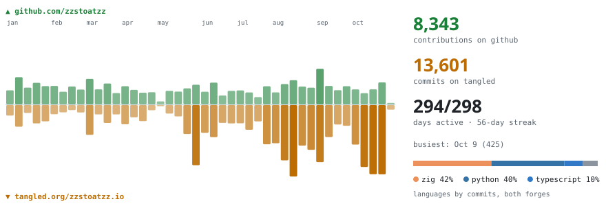
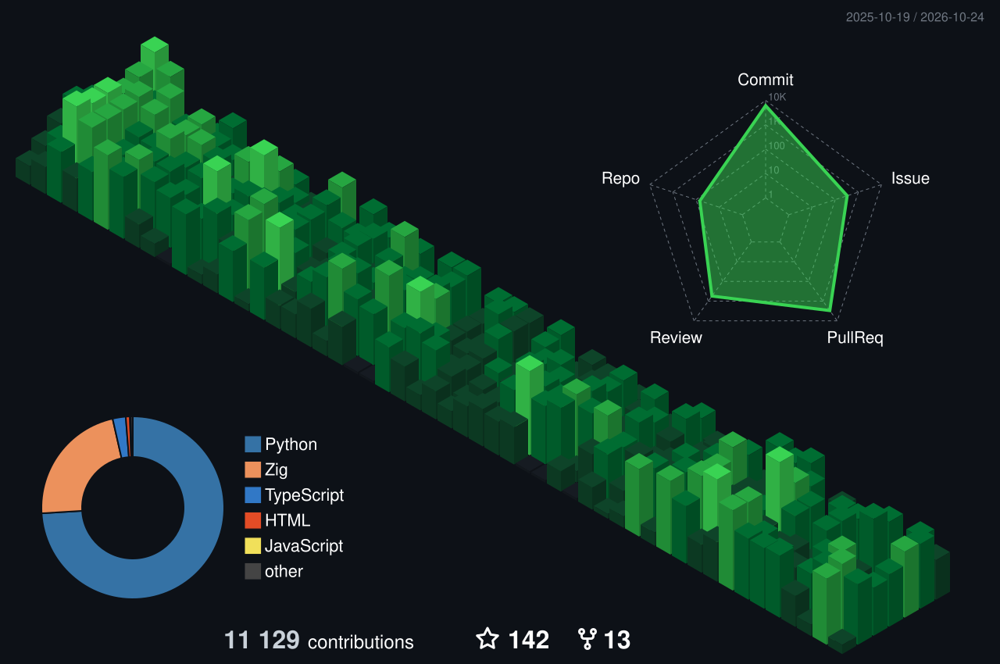

## 👋 hello, I'm nate

oss maintainer and maker of tools @ [prefect](https://github.com/prefecthq/prefect)

### i am likely to be focusing on:
- [atproto](https://waow.tech)
- UX, design or [music](https://plyr.fm)
- presenting ai with data to [make better choices](https://bsky.app/profile/zzstoatzz.io/post/3mg3pusyrs22s)
- building and maintaining tools that help me do that: [`fastmcp`](https://github.com/jlowin/fastmcp), or [`pub-search`](https://pub-search.waow.tech)

  
my background

#### _Prefect_ (Present) - **Senior Software Engineer**
- Finding new and compelling ways to make use of our OSS offerings
- Channeling community feedback into all Prefect interfaces (API, SDK, MCP)
- Working with leadership to distill sane-default products from complex and varying enterprise user needs
- Proofing and maintaining [`fastmcp`](https://github.com/jlowin/fastmcp)
- Building AI-powered systems to automate toil-rich internal tasks
- [Using low-level languages](https://tangled.org/zzstoatzz.io/prefect-server) to minimize waste

#### _Prefect_ - **Software Engineer**
- Designed and implemented a Celery-replacing asynchronous task queue to Prefect open-source and Prefect Cloud
- Contributed to upstream and downstream open-source projects like [`pydantic`](https://github.com/pydantic/pydantic) and [`chromadb`](https://github.com/chroma-core/chromadb)
- [Brought AI into Prefect Cloud](https://www.prefect.io/blog/introducing-error-summaries)
- Designed, implemented and managed open-source autonomous systems like our [slackbot](https://github.com/PrefectHQ/marvin/tree/main/examples/slackbot)

#### _SLATE_ (acq by Prefect, Oct 2021) - **Data Engineer**
- Built custom IaC, ETL, and data modeling for customers (dbt, snowflake, databricks, duckdb, prefect, etc)
- Translated business logic from leaders into maintainable / transparent data pipelines
- Implemented supporting web-apps for customers to interact with their data

---

### education
- **University of Michigan - Ann Arbor**
  - **Major**: Chemical Engineering
  - **Minor**: Physics
  - **Alumnus**: August 2020

  
github stats

<picture>
  <source media="(prefers-color-scheme: dark)" srcset="./forges-dark.svg">
  
</picture>

---

---

[detailed contribution breakdown](./contribution.md)

